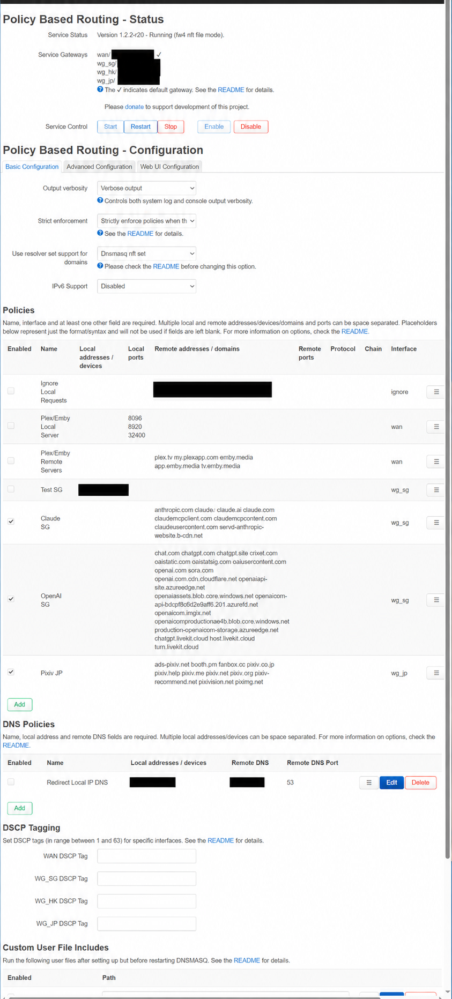
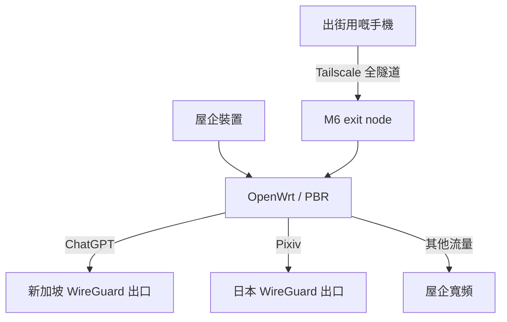
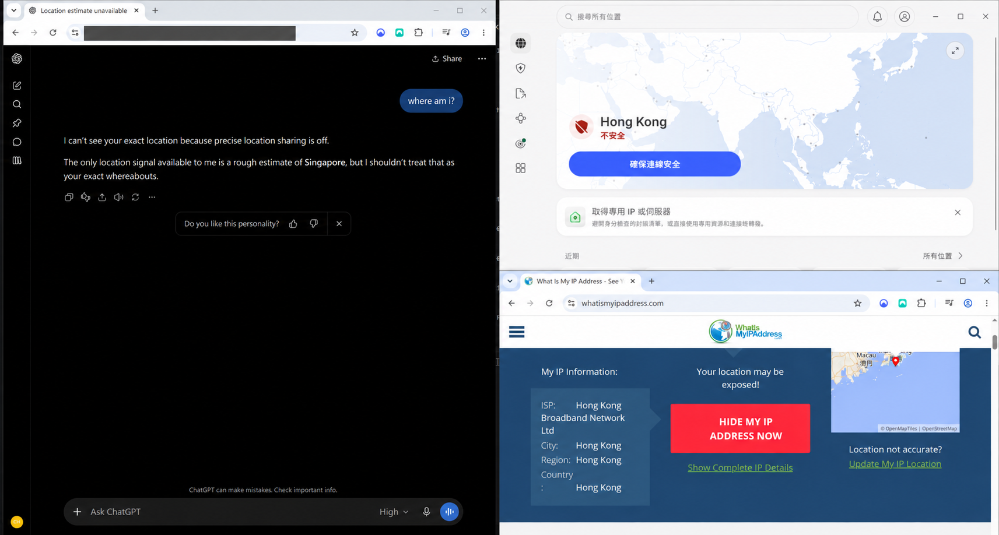

## 簡介

我想用 ChatGPT 嗰陣自動行 VPN，其他網站就照用屋企條線。出街用手機，都想經 Tailscale 連返屋企，用返同一套分流。

個諗法受 [Eric Leung 呢篇文](https://ericleung.dev/posts/009_subscribing_to_openai/)啟發，尤其係佢講 OpenWrt 同 Tailscale 嗰兩節。同[上次升級 Hugo]()一樣，今次卡住嘅時候我會貼截圖同 terminal 輸出畀 AI 一齊睇。下面啲圖已經遮咗 key 同網絡地址。

## 由舊路由器開始

屋企有部舊 ASUS RT-AC68U，我就攞佢做主路由。原本套 NETGEAR SXR50 mesh 繼續負責 Wi-Fi 同有線連接，轉做 AP 模式，駁喺 AC68U 後面。NanoPi M6 本身已經跑緊 AdGuard Home，負責 DNS 同 DHCP，今次再加埋 Tailscale。

裝 OpenWrt 嗰陣，明明 ping 到部機，但瀏覽器點開都 timeout。後尾終於入到 ASUS CFE 復原頁面，先喺嗰度上載韌體。


入到 LuCI 又有另一個問題，裝 WireGuard 嗰陣話搵唔到相依套件 `ip`。


我用 `owut` 由 OpenWrt 25.12.4 升到 25.12.5，更新套件清單，再喺 terminal 裝 `luci-proto-wireguard`。呢次喺介面選單終於見到 WireGuard。

## 邊啲網站行 VPN

我匯入咗 Surfshark 嘅新加坡、香港同日本 WireGuard 設定，再用 `pbr`（策略路由）揀邊啲流量去邊度。

| 流量 | 出口 |
| --- | --- |
| OpenAI / ChatGPT | 新加坡 `wg_sg` |
| Pixiv | 日本 `wg_jp` |
| 其他 | 屋企原本條寬頻 |

香港條 tunnel 都有留低。WAN 繼續做預設路由，WireGuard peer 嘅 **Route Allowed IPs** 我就冇開，費事佢哋自己加多條預設路由。



淨係加 `chatgpt.com` 都未夠，登入、圖片等請求可以用唔同 domain。圖入面係當時嘅清單，日後網站改咗就要跟住執。

## 點解要改 DNS

屋企啲裝置本身問 AdGuard Home 攞 DNS 答案。OpenWrt 都要見到相關查詢，先知道邊啲 IP 應該行邊條 tunnel。WireGuard 握手成功，只係代表條線通咗。

我跟 [PBR 文件](https://docs.mossdef.org/pbr/)，將路由器嘅 `dnsmasq` 換成 `dnsmasq-full`，喺 PBR 揀 **Dnsmasq nft set**。AdGuard 遇到清單入面嘅 domain 就交畀 OpenWrt 解析，其餘照用 AdGuard 平時嘅上游 DNS。

```text
裝置 → AdGuard Home → OpenWrt dnsmasq-full → 上游 DNS
                             ↓
                      將地址加入 PBR 集合
```

DHCP 繼續由 AdGuard 負責。OpenWrt 嘅 DHCP 可以關，但佢嘅 DNS 要開住。

測試嗰陣我一路睇 `wg show wg_sg` 同 PBR 目的地址集合。睇到最近嘅握手時間、收發數字有郁，集合入面亦有地址。呢幾樣畀我判斷到邊部分有反應，但我未逐個請求追過條路。


## 出街用手機

M6 直接跑 Tailscale。我開咗封包轉送，將 M6 設為 [exit node](https://tailscale.com/docs/features/exit-nodes)，喺 Tailscale 批准，再喺手機揀返佢。手機嘅上網流量先返屋企，再由 OpenWrt 揀出口：



手機揀咗 M6 之後，查 IP 網站由顯示流動網絡商變成屋企嘅寬頻商，即係已經連返屋企。個查詢網站本身係行 WAN；要確認手機上 ChatGPT 嗰下有冇經新加坡，仲要對返 WireGuard 流量。

[Tailscale 通常會用 exit node 嘅 DNS](https://tailscale.com/docs/reference/dns-in-tailscale#nameservers-and-exit-nodes)，所以 M6 嘅 DNS 查詢都要去到 OpenWrt 嘅 domain 規則。我亦開咗 subnet routing，出街都入到路由器管理頁。後來試過唔揀 exit node，用 App Connector 淨係將指定網站流量送返屋企。不過我最初想要嘅，係手機成條線都經屋企出。

## 實際用落點

電腦上嘅 VPN app 冇連線，我照樣用到 ChatGPT。隔籬個查 IP 網站就顯示返平時嗰間香港寬頻商。



ChatGPT 喺答案提到新加坡，我唔會用佢嗰句嚟驗證實際出口。

平時行 WAN 測到大約 680–740 Mbps，行新加坡 WireGuard 就大約 100–130 Mbps。手機經 Tailscale 返屋企再行 WireGuard，速度都差唔多。

試完我備份咗 OpenWrt 同 AdGuard 嘅設定。屋企用到分流，出街都可以用手機連返嚟。

## 相關連結

- [啟發我試呢個設定嘅 Eric Leung 文章](https://ericleung.dev/posts/009_subscribing_to_openai/)
- [OpenWrt 嘅 ASUS RT-AC68U 資料](https://openwrt.org/toh/asus/rt-ac68u)
- [PBR 文件](https://docs.mossdef.org/pbr/)
- [Tailscale exit node 文件](https://tailscale.com/docs/features/exit-nodes)
- [Tailscale 嘅 DNS 同 exit node](https://tailscale.com/docs/reference/dns-in-tailscale#nameservers-and-exit-nodes)
