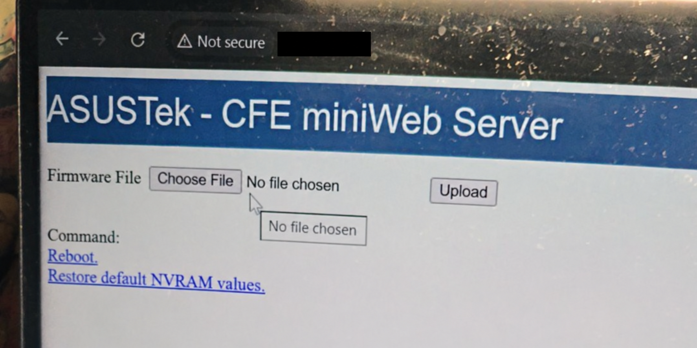
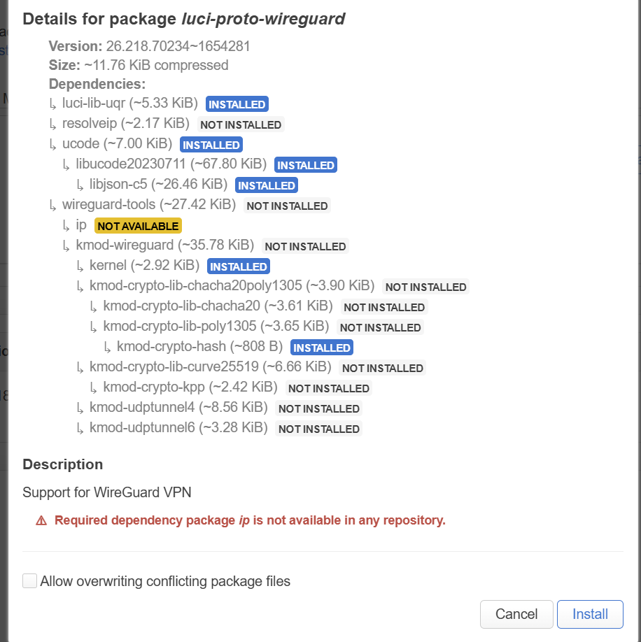
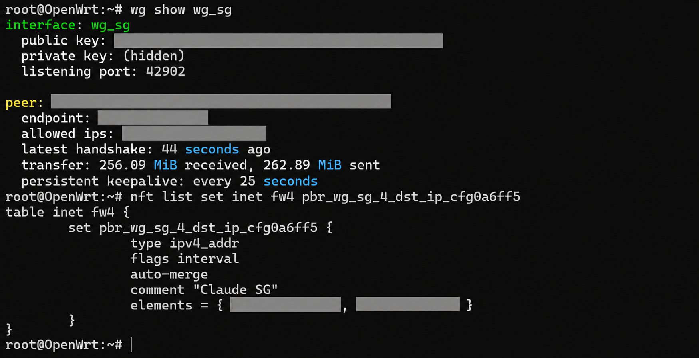
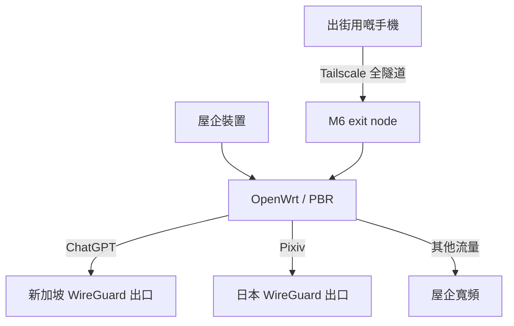

我用 ChatGPT 嗰陣唔想次次都開 VPN，尤其係其他網站用屋企條線已經得。我想個 router 幫我揀：去 ChatGPT 就行 VPN，其他照舊。出街用手機，只要經 Tailscale 連返屋企就用得返同一套設定。

睇完 [Eric Leung 篇文](https://ericleung.dev/posts/009_subscribing_to_openai/)入面講 OpenWrt 同 Tailscale 嗰兩節，我就想用屋企部舊 ASUS 試吓。今次同[上次升級 Hugo]()一樣，卡住就 cap 圖或者貼段 log 畀 AI 睇。下面啲圖遮咗 key 同 IP。

## 由舊路由器開始

我用 RT-AC68U 做主 router，原本嗰套 NETGEAR SXR50 mesh 就轉 AP 模式，駁喺 ASUS 後面繼續做 Wi-Fi 同有線網絡。至於 Tailscale，我裝咗喺 NanoPi M6。佢本身已經用 AdGuard Home 做緊 DNS 同 DHCP。

裝機嗰陣最奇怪係明明 ping 到部 ASUS，但一開管理頁就 timeout。後來入到 ASUS CFE 個 recovery page，先至喺嗰度上載到 OpenWrt。



入到 LuCI，諗住可以裝 WireGuard，點知又話搵唔到佢要用嘅 `ip` 套件。



我用 `owut` 由 OpenWrt 25.12.4 升到 25.12.5，更新套件清單，再喺 terminal 裝 `luci-proto-wireguard`。呢次喺介面選單終於見到 WireGuard。

## 邊啲網站行 VPN

我匯入咗 Surfshark 嘅新加坡、香港同日本 WireGuard 設定，再用 `pbr`（策略路由）揀邊啲流量去邊度。

| 流量 | 出口 |
| --- | --- |
| OpenAI / ChatGPT | 新加坡 `wg_sg` |
| Pixiv | 日本 `wg_jp` |
| 其他 | 屋企原本條寬頻 |

香港條 tunnel 都有留低。WAN 繼續做預設路由，WireGuard peer 嘅 **Route Allowed IPs** 我就冇開，費事佢哋自己加多條預設路由。


淨係加 `chatgpt.com` 都未夠，登入、圖片等請求可以用唔同 domain。圖入面係當時嘅清單，日後網站改咗就要跟住執。

## 點解要改 DNS

我填落 PBR 嘅係 domain，但 router 送封包嗰陣睇嘅係 IP。問題係屋企啲機一路都用 AdGuard Home 做 DNS。如果 AdGuard 自己答咗，OpenWrt 又點知今次查到邊個 IP？

我跟 [PBR 文件](https://docs.mossdef.org/pbr/)，將路由器嘅 `dnsmasq` 換成 `dnsmasq-full`，喺 PBR 揀 **Dnsmasq nft set**。AdGuard 遇到清單入面嘅 domain 就交畀 OpenWrt 解析，其餘照用 AdGuard 平時嘅上游 DNS。

```text
裝置 → AdGuard Home → OpenWrt dnsmasq-full → 上游 DNS
                             ↓
                      將地址加入 PBR 集合
```

DHCP 繼續由 AdGuard 負責。OpenWrt 嘅 DHCP 可以關，但佢嘅 DNS 要開住。

我用 `wg show wg_sg` 睇到新加坡條 tunnel 有握手，收發數字都有郁。再睇 PBR 個 set，入面搵到頭先 DNS 查返嚟嘅 IP。咁就知條 tunnel 通，個分流規則亦收到地址。至於 app 入面每個 request 行咗邊，我冇逐個追。



## 出街用手機

M6 直接跑 Tailscale。我開咗封包轉送，將 M6 設為 [exit node](https://tailscale.com/docs/features/exit-nodes)，喺 Tailscale 批准，再喺手機揀返佢。手機嘅上網流量先返屋企，再由 OpenWrt 揀出口：



我喺手機試咗一次。揀 M6 之前，查 IP 個網顯示我嘅手機網絡商，揀完就見到屋企用嗰間寬頻公司。咁我就知手機已經連返屋企。查 IP 個網本身行 WAN，要睇 ChatGPT 有冇行新加坡，仲要對返 WireGuard 嘅流量。

[Tailscale 通常會用 exit node 嘅 DNS](https://tailscale.com/docs/reference/dns-in-tailscale#nameservers-and-exit-nodes)，所以 M6 嘅 DNS 查詢都要去到 OpenWrt 嘅 domain 規則。我亦開咗 subnet routing，出街都入到路由器管理頁。後來試過唔揀 exit node，用 App Connector 淨係將指定網站流量送返屋企。不過我最初想要嘅，係手機成條線都經屋企出。

## 實際用落點

電腦上嘅 VPN app 冇連線，我照樣用到 ChatGPT。隔籬個查 IP 網站就顯示返平時嗰間香港寬頻商。


我問 ChatGPT「where am i?」，佢估係新加坡。呢個係佢估嘅位置，實際行邊條線仲要睇返 router。

平時行 WAN 測到大約 680–740 Mbps，行新加坡 WireGuard 就大約 100–130 Mbps。手機經 Tailscale 返屋企再行 WireGuard，速度都差唔多。

試通之後，我就備份咗 OpenWrt 同 AdGuard 嘅設定。

## 相關連結

- [啟發我試呢個設定嘅 Eric Leung 文章](https://ericleung.dev/posts/009_subscribing_to_openai/)
- [OpenWrt 嘅 ASUS RT-AC68U 資料](https://openwrt.org/toh/asus/rt-ac68u)
- [PBR 文件](https://docs.mossdef.org/pbr/)
- [Tailscale exit node 文件](https://tailscale.com/docs/features/exit-nodes)
- [Tailscale 嘅 DNS 同 exit node](https://tailscale.com/docs/reference/dns-in-tailscale#nameservers-and-exit-nodes)
