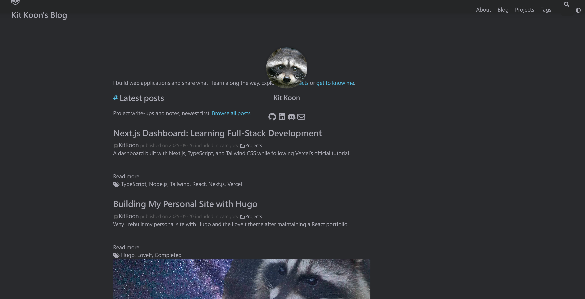

本來只係想升一升 Hugo。個 blog 而家個樣我幾鍾意，唔想升完要由頭砌過。

結果真係換咗主題，好在隻浣熊留得低。最初點解揀 LoveIt，我喺[整個站嗰篇]()有講。

## 點解換 DoIt

我同 AI 先試最少改動嗰個做法：照用 LoveIt，淨係升 Hugo 去 0.166.0。一 build 就報錯。DoIt 本身由 LoveIt 改出嚟，排版、深色模式同上面行 menu 都幾似舊版，所以我哋揀咗佢。

| 元件 | 之前 | 之後 |
| --- | --- | --- |
| Hugo Extended | 0.145.0 | 0.166.0 |
| 主題 | LoveIt | DoIt v1.0.2 |

兩個版本都固定咗，下次升級可以開另一條 branch 慢慢試。

## 同 AI 點樣分工

我叫 AI 睇個 repo、比較主題，再落手改。佢改咗設定、將搜尋換成 Fuse.js，加埋 build script 同 GitHub 嘅 build check。

中途仲執咗文章封面、浣熊標誌對齊，同埋窄螢幕上面嘅頁首。搜尋本身會搵到幾個相同結果，我哋改咗個 template，每頁只出現一次，亦唔會再喺冇日期嘅頁面顯示 `0001` 年。

我負責喺本機試、睇返啲改動，再處理 Cloudflare 設定同 pull request。部署失敗嗰陣，我就將 log 貼返入對話一齊搵原因。

## 舊網址同 RSS

當時得八篇文，但計埋分類同其他頁面，原來已經有 68 條網址。換完主題，我對返舊網址同出文日期，再試搜尋、圖片、手機版、深色模式同留言。

我特別想保留 `/posts/index.xml`。本機打開 `http://localhost:1313/posts/index.xml` 正常，原有嘅[英文 RSS](/posts/index.xml) 亦沿用同一條網址。Utterances 留言係靠文章路徑搵返對應嘅 GitHub issue，保留路徑同 repo，舊留言就繼續用得。

## Cloudflare 一直裝返舊版 Hugo

本機同 GitHub 都 build 到，但 Cloudflare Preview 個 log 寫住：

```text
Installing hugo extended_0.145.0
```

Script 要求 0.166.0，所以即刻停咗。我改完設定再試，個 log 仲係 0.145.0。

原來要改嘅係 **Preview**。Cloudflare 將 Preview 同 Production 分開，而我條 branch 用緊 Preview。Repo 入面嘅 `.hugo-version` 冇幫我改到 Cloudflare 裝邊個版本。

| Cloudflare Pages 設定 | 值 |
| --- | --- |
| Build command | `bash scripts/build.sh --gc` |
| Output directory | `public` |
| Preview 同 Production 嘅環境變數 | `HUGO_VERSION=0.166.0` |

改完 Preview 就部署到。兩個 check 都過，我 merge 入 `master`，再確認正式網站已經跑緊新版，RSS 亦開到。

## 點解隻浣熊遮住段字

一開正式網站就見到下面咁。隻浣熊疊咗喺段自我介紹上面，我仲以為換主題嗰陣整壞咗個版。



清咗 browser cache，再撳 refresh，隻浣熊就返返去原位。

## 參考

- [Hugo 0.166.0](https://github.com/gohugoio/hugo/releases/tag/v0.166.0)
- [DoIt v1.0.2](https://github.com/HEIGE-PCloud/DoIt/releases/tag/v1.0.2)
- [Cloudflare Pages 嘅 Hugo 版本設定](https://developers.cloudflare.com/pages/framework-guides/deploy-a-hugo-site/#use-a-specific-or-newer-hugo-version)
- [網站原始碼](https://github.com/ChrisWK51/ChrisWK51)
- [建構同部署筆記](https://github.com/ChrisWK51/ChrisWK51/blob/master/docs/site-maintenance.md)
